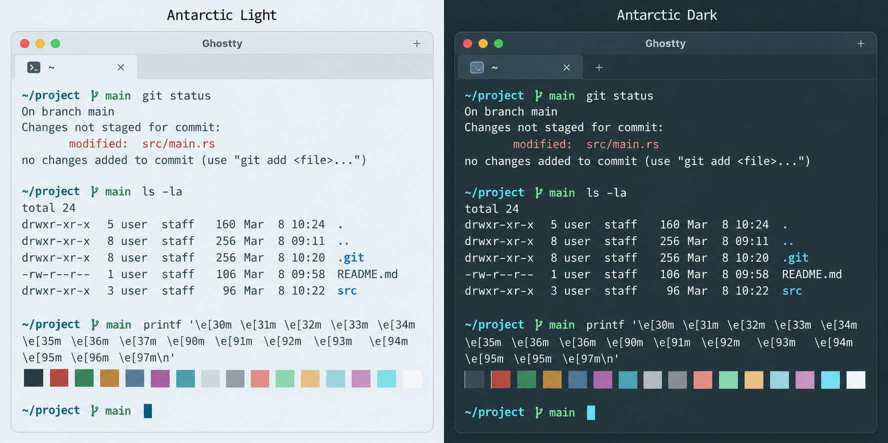

# Antarctic for Ghostty

Light and dark themes based on the shared [Antarctic palette](https://github.com/AntarcticTheme/.github/blob/main/profile/README.md).



## Requirements

Install [Ghostty](https://ghostty.org/docs/install/binary) on macOS or Linux. 

## Install

Download both themes:

Make sure you have the folder `"$HOME/.config/ghostty/themes"` already created.

```sh
curl -fL https://raw.githubusercontent.com/AntarcticTheme/Ghostty/main/themes/Antarctic-Light -o "$HOME/.config/ghostty/themes/Antarctic-Light"
curl -fL https://raw.githubusercontent.com/AntarcticTheme/Ghostty/main/themes/Antarctic-Dark -o "$HOME/.config/ghostty/themes/Antarctic-Dark"
```

Add to your Ghostty config (typically `~/.config/ghostty/config.ghostty`):

```conf
theme = Antarctic-Dark
```

Use `Antarctic-Light` for light mode. 

To follow system appearance automatically:

```conf
theme = dark:Antarctic-Dark,light:Antarctic-Light
```

Includes all 16 ANSI colors, foreground, background, cursor, and selection.

## Updates

To update, repeat the download/copy steps, then restart the application or reload its configuration.

Released under the MIT license. See [LICENSE](LICENSE).
